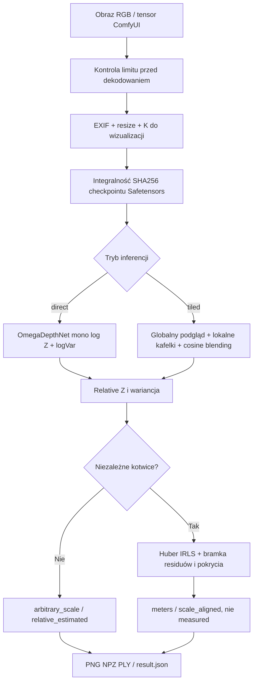

# Architektura wykonawcza OMEGA GeoDepth Ω 0.2.0

## Kluczowe kontrakty

1. Rozdzielenie estymacji od pomiaru: unit i provenance, brak metra bez kotwicy.
2. Geometria camera-to-world `pose_c2w` i optyczna głębia Z są jawne. Rozróżnienie Z od odległości promienia ρ.
3. Głębokość kafelkowa: globalny przewodnik log Z, medianowe dopasowanie gauge, ograniczone korekty, gładkie okna z niezerową wagą na krawędzi.
4. Uncertainty: `sigma_log_z`; kwantyle odrzucane dla rozdzielczości lub trybów bez dowodu kalibracji.
5. Wejścia: limit 24MP **przed** EXIF-transpose, model bez dostępu do sieci, SHA-256 wag, ograniczenie max 4096 boku przetwarzanego obrazu.
6. Wyjścia: atomowe pliki, `result.json` zapisany jako ostatni znacznik zakończenia; brak gwarancji transakcji pomiędzy plikami.

## Macierz dowodów

| Komponent | Status | Zakres dowodu |
|---|---|---|
| Wagi sieci 0.2 i TorchScript | Lokalnie potwierdzone | Checksum, forward, zgodność dla 3 kształtów |
| Inferencja kafelkowa | Lokalnie potwierdzona | Test pokrycia / odrzucenia błędnych parametrów / rzeczywisty checkpoint |
| Quality Gate kotwic | Lokalnie potwierdzona | Rozmieszczenie, outliery, błąd residualny |
| Konformalna kalibracja | Syntetyczna | Osobne 112 scen audytowych, bez real-data guarantee |
| ComfyUI | Częściowa | Test adaptera V1, brak testu działającego procesu GUI |
| Model DA3, 10 trybów, pełna 4D | Brak | Brak checkpointów / implementacji / testów integracyjnych |
| Android Termux / APK | Brak | Brak środowiska urządzenia |
| 400MP out-of-core / RAW | Brak | Limit 24MP i RGB in-memory |
| Produkcja multi-tenant / sygnatury | Brak | Brak signer / KMS / e2e kontrola domen |

Specyfikacja odniesienia: `SYS-AETHERIS-VISION-GEO-003`, załączony 80-stronicowy dokument. Sama implementacja tej części nie realizuje wszystkich opisanych tam kontraktów.

## Rozszerzenie architektoniczne v0.3.0

`DA3 official source + verified local checkpoint` → `DA3OfflineBackend` → `DA3Output` (N,Z,confidence,K,T_c2w,RGB) → `Frame5D` → `Scene5D` (temporal voxel aggregation, NN scene flow) → PLY/NPZ + independent OBJ/TSDF time slices + observed-only sparse renderer. Alternative input: previously saved OMEGA `depth_geometry.npz` plus explicit K/pose and timestamp manifest.

5D oznacza **XYZ + t + L**, gdzie L jest niezależną obserwowaną cechą wyglądu, a nie wymiarem fizycznej przestrzeni. Nie wolno reklamować tego jako pełnego rozwiązania 5D neural rendering. Brak pochodzenia kalibracji oraz rzeczywistych wag DA3 blokuje metryczną certyfikację systemu.

## Rozszerzenie v0.4.0 (potwierdzone testami)

- **Static multiview fusion**: nowy `multiview_tsdf.py` integruje skalibrowane mapy głębi z wielu kamer do wspólnego TSDF, z liczbą obserwacji i obowiązkowym limitem wokseli. Przy materiałach dynamicznych wejście wymaga odpowiedniego oznaczenia maską statyczności; brak maski jest jawnym założeniem, nie dowodem.
- **Spatiotemporal correspondences**: wzajemne korespondencje KD-tree z bramką fotometryczną i dwustronnym wektorem prędkości, bez twierdzeń o rzeczywistym optical-flow ground truth.
- **Gaussian field rasterizer**: `gaussian5d.py` rzutuje ograniczony rozmiarem zestaw surfeli gaussowskich, uwzględniając Z-buffer, bliski czas i kanał alpha. Nie trenuje 4DGS, nie jest pełnym shaderem fizycznym.
- **Bramki testowe**: syntetyczna statyczna scena trzech kamer, regresje maski wewnętrznej, renderowanie czasowe, eksport i SHA-256.
- **Bramka DA3**: prawdziwe wagi i oficjalne środowisko DA3 nadal nieobecne; pozostał adapter fail-closed.

## Rozszerzenie v0.5.0 — uczone gaussy dynamiczne

Strumień `Frame5D (RGB,K,T_c2w,Z,t) -> sampled observed XYZ -> TrainableGaussian4D -> differentiable alpha compositing -> photometric+depth optimizer -> Safetensors checkpoint -> time-conditioned rendering`. Względne Z oraz niepewne dane pozostają tak oznaczone, nie są przeliczane na metry. Maksymalna liczba uczonych splatów to 512, budżet par splat-piksel to 2 000 000 na render.

Oddzielna bramka **DA3 G0** wymaga SHA-256 zgodnego z oficjalnym hashem repozytorium wag (Small/Base), odrzuca symlinki, sprawdza kształty i dozwolone konstruktory konfiguracji. Manifest utworzony lokalnie nie wystarcza do uznania checkpointu za autentyczny.

Wydanie v0.5 nie obejmuje pełnego odtworzenia dynamicznego 4DGS metodą neuronowej deformacji 3D, metrycznej rekonstrukcji 5D na danych realnych ani działania oficjalnego DA3 bez checkpointu.

## Warstwa deformacji v0.6

Moduł `deformable_4dgs.py` nie modyfikuje kontraktu warstw DA3 ani TSDF.
Każda gaussowska próbka świata ma bazową pozycję `x0`, prędkość `v`, węzły
czasowe i uczone przesunięcia `a_k`. Przesunięcie jest interpolowane przez
znormalizowane RBF, zakotwiczone do `reference_time`. Obliczanie i uczenie
przechodzą przez istniejący differentiable Gaussian renderer; wynik to
`XYZ(t),RGB(t),alpha(t),Z(t)`, nie 5 wymiarów przestrzennych.
Zaimplementowano ścisłą kontrolę przedziału czasu, skończoności parametrów,
spójności jednostek i integralności plików. Względem v0.5 dodatkowe parametry
przechowywane są w oddzielnym schemacie checkpointu; istniejące wagi zachowano.

## Dodatek v0.7.0 — DA3 user-supplied source ZIP
Dostarczone oryginalnie zapakowane źródła DA3 objęte deklarowaną licencją Apache-2.0 (szczegóły `vendor/Depth-Anything-3-main.zip`/LICENSE). SHA-256 paczki użytkownika nie jest poświadczeniem upstream. Kod zachowany bez modyfikacji. Oryginalnych wag DA3 nadal brak. Nowy audyt reprojekcji kontroluje wyłącznie względną spójność wielowidokową, nie dokładność metryczną. Patrz `docs/ZMIANY_v0.7_PL.md`.
